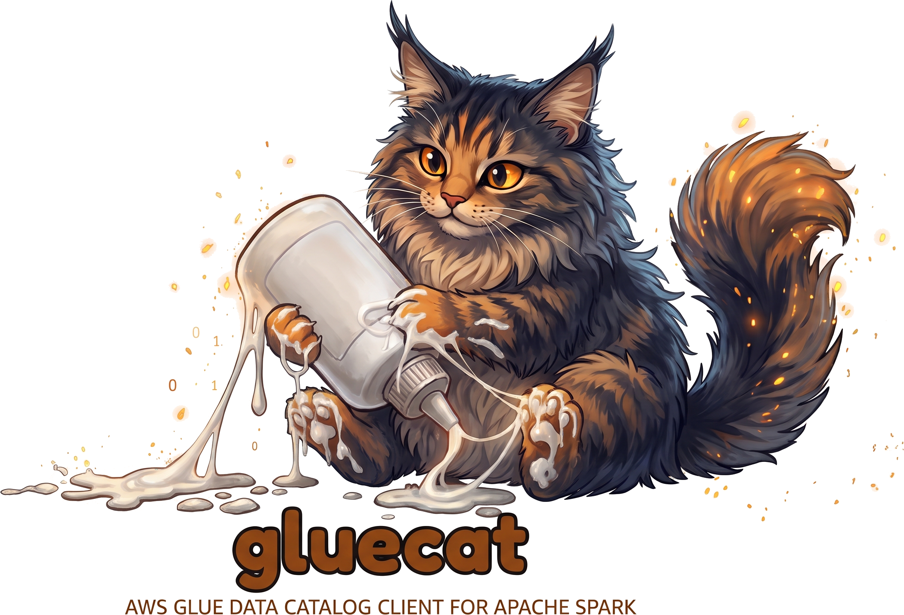

<p align="center">
  
</p>

# gluecat

AWS Glue Data Catalog client for Apache Spark.

Documentation: <https://sdaberdaku.github.io/gluecat/>

gluecat is a Spark catalog plugin, `io.github.sdaberdaku.gluecat.GlueCatalog`. Each Spark catalog configured with it
talks to one Glue Data Catalog, with its own catalog ID and its own credentials or IAM role. It loads, creates and
alters Delta tables there, reads other data source tables, and manages Glue databases. It works as a named catalog
and as `spark_catalog`. It does not use the Hive metastore client, needs no patched Spark or Hive jars, and uses the
AWS SDK for Java v2.

## Why

Out of the box, Delta Lake works only through Spark's built-in session catalog, `spark_catalog`, and the session
catalog sits on a single Hive metastore client. With the AWS Glue Hive client, that means one Glue catalog ID and one
set of credentials for the whole Spark application.

When each customer, team or environment has its own AWS account, the S3 data can already live in each account (S3A
handles per-bucket access), but every Delta table still has to be registered in one shared Glue catalog. A single
Spark application, for example a Spark Connect server that runs jobs for several accounts, cannot register account
A's tables in account A's Glue and account B's tables in account B's Glue.

Iceberg's `GlueCatalog` already gives each named catalog its own Glue catalog ID and IAM role. gluecat brings that
model to Glue tables in general and to Delta tables in particular. Its option names follow Iceberg's AWS properties.

## Artifacts

One artifact per Spark minor version and Scala version, group `io.github.sdaberdaku`:

| Artifact | Spark | Scala | Java bytecode | JDKs tested | Delta tested |
|---|---|---|---|---|---|
| `gluecat-spark-3.5_2.12` | 3.5.3 and later 3.5 | 2.12 | 8 | 8, 11, 17 | 3.3.3 |
| `gluecat-spark-3.5_2.13` | 3.5.3 and later 3.5 | 2.13 | 8 | 8, 11, 17 | 3.3.3 |
| `gluecat-spark-4.0_2.13` | 4.0.x | 2.13 | 17 | 17, 21 | 4.0.1, 4.1.0, 4.2.0, 4.3.1, 4.4.1 |
| `gluecat-spark-4.1_2.13` | 4.1.x | 2.13 | 17 | 17, 21 | 4.1.0 and 4.2.0 (on Spark 4.1.1), 4.3.1, 4.4.1 |
| `gluecat-spark-4.2_2.13` | 4.2.x | 2.13 | 17 | 17, 21, 25 | 4.4.1 |

Spark 3.5.0 to 3.5.2 are not supported: they reject the tables this catalog returns for non-Delta data, and
`initialize` fails on them. `matrix.json` lists every Spark, Delta and JDK combination CI runs.

Delta is optional: without Delta on the classpath, the catalog serves non-Delta tables only.

## Quick start

More detail: [quick start](https://sdaberdaku.github.io/gluecat/quickstart/).

### Dependencies

gluecat needs the AWS SDK v2 modules `glue` and `sts` on the Spark classpath; the jar contains no SDK classes.

- Spark 3.5 (Hadoop 3.3, whose S3A uses SDK v1): add them yourself, for example
  `--packages software.amazon.awssdk:glue:2.24.6,software.amazon.awssdk:sts:2.24.6`.
- Spark 4.x: when `hadoop-aws` (S3A) is on the classpath, the `software.amazon.awssdk:bundle` it depends on already
  contains both. Otherwise add them as for Spark 3.5.

Example for Spark 4.1 with Delta 4.4.1, without `hadoop-aws`:

```
spark-sql --packages io.github.sdaberdaku:gluecat-spark-4.1_2.13:1.0.0,io.delta:delta-spark_4.1_2.13:4.4.1,software.amazon.awssdk:glue:2.24.6,software.amazon.awssdk:sts:2.24.6
```

### As named catalogs

One named Spark catalog per Glue catalog (`spark-defaults.conf` or `--conf`; keep comments on their own lines):

```
spark.sql.extensions                                     = io.delta.sql.DeltaSparkSessionExtension
spark.sql.catalog.spark_catalog                          = org.apache.spark.sql.delta.catalog.DeltaCatalog

spark.sql.catalog.acct_a                                 = io.github.sdaberdaku.gluecat.GlueCatalog
spark.sql.catalog.acct_a.glue.id                         = 111111111111
spark.sql.catalog.acct_a.client.region                   = eu-central-1
spark.sql.catalog.acct_a.client.assume-role.arn          = arn:aws:iam::111111111111:role/glue-access
# optional
spark.sql.catalog.acct_a.warehouse                       = s3://bucket-a/warehouse

spark.sql.catalog.acct_b                                 = io.github.sdaberdaku.gluecat.GlueCatalog
spark.sql.catalog.acct_b.glue.id                         = 222222222222
spark.sql.catalog.acct_b.client.region                   = eu-central-1
spark.sql.catalog.acct_b.client.assume-role.arn          = arn:aws:iam::222222222222:role/glue-access
```

The first two lines are Delta's usual session configuration; Delta's SQL commands (`MERGE`, `UPDATE`, `DELETE`,
`OPTIMIZE`, `VACUUM`, ...) need the extension.

```sql
CREATE DATABASE acct_a.db LOCATION 's3://bucket-a/warehouse/db.db';
CREATE TABLE acct_a.db.events (id BIGINT, kind STRING) USING delta;
INSERT INTO acct_a.db.events VALUES (1, 'a');
CREATE TABLE acct_b.db.events USING delta LOCATION 's3://bucket-b/db/events' AS SELECT * FROM acct_a.db.events;
```

A catalog never calls any Glue catalog other than its own `glue.id`.

### As `spark_catalog`

`GlueCatalog` can replace the built-in session catalog, so unqualified `db.table` names and tools that assume
`spark_catalog` go to Glue without the Hive client:

```
spark.sql.extensions                          = io.delta.sql.DeltaSparkSessionExtension
spark.sql.catalogImplementation               = in-memory
spark.sql.catalog.spark_catalog               = io.github.sdaberdaku.gluecat.GlueCatalog
spark.sql.catalog.spark_catalog.glue.id       = 111111111111
spark.sql.catalog.spark_catalog.client.region = eu-central-1
# more catalogs as usual
spark.sql.catalog.acct_b                      = io.github.sdaberdaku.gluecat.GlueCatalog
spark.sql.catalog.acct_b.glue.id              = 222222222222
```

`spark.sql.catalogImplementation = in-memory` is required. Spark's in-memory catalog stays in place for temporary
views and functions, which work as usual. Spark also sends `CREATE VIEW` and `CREATE FUNCTION` to that in-memory
catalog, which has only a `default` database: a view in a Glue database fails with `SCHEMA_NOT_FOUND`, and a view in
`default` exists in memory only, for the lifetime of the application. Nothing of this reaches Glue. The operation
tests run in both modes; the credentials, account isolation and concurrency tests use named catalogs.

## Configuration

Options go under `spark.sql.catalog.<name>.`. More detail:
[configuration](https://sdaberdaku.github.io/gluecat/configuration/).

| Option | Default | Meaning |
|---|---|---|
| `glue.id` | not set: the caller's account | Glue catalog ID (AWS account ID), sent as `CatalogId` on every Glue call. |
| `glue.endpoint` | SDK default | Endpoint override for the Glue client only (not STS). |
| `glue.skip-archive` | `true` | `SkipArchive` on every Glue `UpdateTable`. |
| `client.region` | SDK default region chain | Region of the Glue client, and of STS unless `client.assume-role.region` is set. |
| `client.credentials-provider` | not set | Class name of an SDK v2 `AwsCredentialsProvider`. Instantiated through a static `create(java.util.Map)`, else a static `create()`, else the no-arg constructor. |
| `client.credentials-provider.<key>` | not set | Passed, without the prefix, to the provider's `create(java.util.Map)`. |
| `client.assume-role.arn` | not set | IAM role to assume through STS for every Glue call. |
| `client.assume-role.external-id` | not set | External ID for the assume-role call. |
| `client.assume-role.session-name` | `gluecat` | Role session name. |
| `client.assume-role.region` | `client.region` | STS region. |
| `client.assume-role.timeout-sec` | `3600` | Session duration in seconds; a positive integer. |
| `warehouse` | not set | Location of databases created without one (`<warehouse>/<db>.db`), and of managed tables in databases without a location: `<warehouse>/<db>.db/<table>`. |
| `default-namespace` | `default` | Database of unqualified table names. Named catalogs only: as `spark_catalog`, Spark takes the current namespace from its built-in session catalog (`default` until `USE`). |

Unknown options under `glue.` and `client.` log a warning and are ignored (Spark passes every
`spark.sql.catalog.<name>.*` option to the catalog, including options meant for Delta). Blank values count as not set.
The catalog never creates a database: if the default database does not exist, unqualified names fail with an error
that names the database and the `glue.id`.

### Credentials

In order of precedence:

1. `client.credentials-provider`: your provider class.
2. `client.assume-role.arn`: an STS assume-role provider. Its base credentials come from the SDK default chain. The
   SDK refreshes the session on the thread of the first Glue call in the 5 minutes before it expires; there is no
   background refresh thread.
3. The SDK default credentials chain, including web identity (IRSA on EKS).

Each catalog builds its own default chain and resolves it at its first Glue call. A `glue.id` of another account
also works without a role if that account's Glue resource policy allows the caller.

- IRSA (web identity) needs the `sts` module on the classpath, like assume role.
- With SDK 2.24.6, assume-role and web identity calls go to the regional public STS endpoint
  (`sts.<region>.amazonaws.com`); `AWS_ENDPOINT_URL` and `AWS_ENDPOINT_URL_STS` are ignored (later SDK versions
  read them). With a local emulator, `glue.endpoint` points Glue at it, but `client.assume-role.arn` still reaches
  the real STS.
- STS VPC interface endpoints work only with private DNS enabled.

### AWS SDK

gluecat is built and tested against SDK 2.24.6, the `bundle` version that `hadoop-aws` 3.4.1 depends on (Hadoop 3.4.1
is the oldest Hadoop that a supported Spark 4.x line bundles). `glue` and `sts` are `provided` dependencies, as in
Iceberg's `iceberg-aws`. Newer 2.x versions on the classpath are expected to work, since the SDK keeps backward
compatibility within 2.x, but CI does not test them; older versions are not supported. gluecat sets the standard retry mode
(3 attempts), which overrides `AWS_RETRY_MODE` (the SDK's own default is the legacy mode), and otherwise keeps the
SDK defaults: no API call timeout, the SDK's default HTTP client resolution. Assume-role sessions
last `client.assume-role.timeout-sec` (3600 s by default) and refresh on the calling thread.

## Supported operations

Integration tests cover these rows in both catalog modes; a few non-Delta details (managed-table locations, column
changes) are covered by unit tests. More detail:
[operations](https://sdaberdaku.github.io/gluecat/operations/).

| Operation | Delta tables | Other data source tables (Parquet, ORC, CSV, JSON, ...) |
|---|---|---|
| `SHOW TABLES`, table exists, `DESCRIBE`, load | Yes; loaded through Delta's `DeltaCatalog` | Yes |
| Reads | Yes, including time travel | Through Spark's file path, only for tables whose partitions are not tracked in Glue; time travel fails (Delta only) |
| `INSERT`, `INSERT OVERWRITE` | Yes | Files are written at the table location through Spark's file path; the Glue entry is not updated (no partitions, no statistics) |
| `MERGE`, `UPDATE`, `DELETE`, `OPTIMIZE`, `VACUUM`, `DESCRIBE HISTORY` by name | Yes | No (Delta only) |
| `CREATE TABLE ... LOCATION` | Yes: creates the Delta table there (or registers the one already there), then the Glue entry | Yes, Glue entry only |
| `CREATE TABLE` without `LOCATION` (managed) | Location from the database location, else `<warehouse>/<db>.db/<table>`; fails with neither | Same, Glue entry only |
| `CREATE TABLE ... AS SELECT`, `df.write.saveAsTable` | Yes, with Delta's semantics (default mode and `overwrite`, with or without the `path` option) | No: fails and points to Delta |
| `REPLACE TABLE`, `CREATE OR REPLACE TABLE`, `REPLACE TABLE ... AS SELECT` | Yes | No |
| `df.writeTo(...)`: `create`, `append`, `overwrite`, `overwritePartitions`, `replace`, `createOrReplace` | Yes; `append` and `overwrite` leave the Glue entry alone | `create`, `replace`, `createOrReplace`: no; `append`, `overwrite`, `overwritePartitions`: not tested |
| Structured Streaming: `writeStream.toTable`, `readStream.table` | Yes; `toTable` creates the table and its Glue entry when missing | Not tested |
| `ALTER TABLE` | Applied by Delta to its log. Column changes (add, drop, rename, type, comment, nullability, position; Delta's own rules apply) also rewrite the Glue columns. `SET LOCATION` needs a Delta table at the target, moves the Glue entry and re-syncs its columns. Properties stay in the Delta log | Properties, comment, top-level columns and location, in the Glue entry |
| `REFRESH TABLE` (SQL) | Re-syncs the Glue columns from the Delta log; needs Glue write access | No-op |
| `ALTER TABLE ... RENAME TO` | Glue entry only; the data stays in place | Same |
| `DROP TABLE` | Removes the Glue entry, never deletes data | Same |
| `DROP TABLE ... PURGE` | Fails | Fails |
| Views, functions | `CREATE VIEW` in a named catalog fails with Spark's `UNSUPPORTED_FEATURE.CATALOG_OPERATION` ("does not support views"); as `spark_catalog`, Spark sends them to its in-memory catalog, which has only `default`, so `CREATE VIEW` in a Glue database fails with `SCHEMA_NOT_FOUND`; temporary views work in both modes | Same |

Path-based Delta operations (`` delta.`s3://...` ``) involve no catalog and work as before.

Databases: `CREATE DATABASE` (comment, location, properties; without a location and with `warehouse` set, the database
is placed at `<warehouse>/<db>.db`, because Spark's Hive path cannot create tables in a database without one),
`ALTER DATABASE`, `DROP DATABASE` (with `CASCADE`, Glue's `DeleteDatabase` removes the database's table entries; table
data is never deleted), `SHOW DATABASES` and `USE`. Glue has single-level namespaces only.
Database and table names are lowercased (Glue stores them in lowercase), so `acct_a.MyDb.MyTable` and
`acct_a.mydb.mytable` are the same table; column names keep their case.

Iceberg tables in Glue fail on load with an error that points to Iceberg's `GlueCatalog`. Glue views are not listed
and cannot be loaded. Hive SerDe tables without `spark.sql.sources.provider` (written by Athena, Glue crawlers or
Trino's Hive connector) fail on load with a clear error.

## Glue entry format

Entries follow the shape Spark's Hive path writes for data source tables (`EXTERNAL_TABLE`, `spark.sql.sources.*`
parameters, the location in the SerDe parameter `path`). Delta entries also carry the real
`StorageDescriptor.Location` and `table_type = DELTA`, which Athena's Delta support reads. Parameters written by other
tools are kept on every update. The format is public API from 1.0.0. Details and reader compatibility:
[Glue entry format](https://sdaberdaku.github.io/gluecat/glue-entry-format/).

## Known limitations

The full list: [limitations](https://sdaberdaku.github.io/gluecat/limitations/).

- One writer per Delta table: Delta-Spark's default S3 LogStore is safe for one driver only, until Delta gets a
  conditional-write LogStore.
- The Glue columns of a Delta table are written at create, replace, `ALTER TABLE` column changes and
  `REFRESH TABLE`, not after schema evolution inside writes (`mergeSchema`, `MERGE ... WITH SCHEMA EVOLUTION`): run
  SQL `REFRESH TABLE` after those. `REFRESH TABLE` on a Delta table needs Glue write access.
  `spark.catalog.refreshTable` does not re-sync the columns.
- Non-Delta tables: only tables whose partitions are not tracked in Glue are readable; `INSERT` writes files but does
  not update the Glue entry; `MERGE`, `UPDATE`, `DELETE`, CTAS and `REPLACE` are Delta only.
- Views and functions: named catalogs refuse `CREATE VIEW` with Spark's `CATALOG_OPERATION` error. As
  `spark_catalog`, persistent views and functions work only in the in-memory catalog's `default` database and live
  only as long as the application; in a Glue database `CREATE VIEW` fails with `SCHEMA_NOT_FOUND`. Temporary views
  work in both modes. Materialized views are not supported.
- Generated columns and column `DEFAULT` values are refused: Spark refuses generated columns because the catalog
  declares no support for them, and Delta refuses `ADD COLUMN ... DEFAULT`.
- `DROP` never deletes data and `PURGE` is not supported. This differs from Spark's managed tables: dropped managed
  tables leave their directories under `<warehouse>/<db>.db/` or the database location, and repeated create and drop
  cycles accumulate data there that has to be cleaned up separately.
- `RENAME` is not atomic: Glue has no rename, so the catalog creates the new entry, then deletes the old one. If the
  delete fails, both entries exist and point at the same location; dropping the old name finishes the rename.
  Renaming a Delta table loads its Delta log first, so a table whose log is missing cannot be renamed.
- `ALTER TABLE ... SET LOCATION` on a Delta table requires a Delta table (a `_delta_log` directory) at the target.
- `REPLACE` cannot move a table: a `LOCATION` other than the current one fails (`s3`, `s3a` and `s3n` count as the
  same scheme, and a trailing slash does not matter).
- Table properties that the catalog keeps in Glue itself (`EXTERNAL`, `table_type`, `transient_lastDdlTime`,
  `spark.sql.*`) cannot be set or removed, and neither can a table-level `collation` (Spark 4.1 and later).
- Delta creates and replaces run on the table path, so they need `spark.sql.runSQLOnFiles = true` (the default); with
  it off they fail before Delta writes anything.
- Delta's `UpdateCatalog` hook would write through `spark_catalog` (see Design notes), so the catalog fails to
  initialize while `spark.databricks.delta.catalog.update.enabled` is `true`. It is a runtime setting: the catalog
  checks it again before every Delta operation by name. While it is on, loads, reads, writes, creates, alters and
  refreshes of tables by name fail; `DROP TABLE`, listings and database operations do not go through the check.
- Concurrent table alters: every Glue `UpdateTable` passes the `VersionId` read before the change, so the second of
  two concurrent alters fails with a retryable error; run the statement again. Glue databases have no `VersionId`, so
  concurrent database alters are last-writer-wins.
- As `spark_catalog` on Spark 4.1 and later, path-based Delta DDL (`` CREATE TABLE delta.`<path>` ``,
  `` REPLACE TABLE delta.`<path>` ``, `ALTER TABLE ... ADD COLUMNS` on a path) makes Spark call `GetDatabase` for a
  database named `delta`, to look up a default collation. Spark ignores the result, but the call shows up in
  CloudTrail, possibly as access denied.
- Delta 4.1.0 and 4.2.0 fail every `ALTER TABLE` on a Delta table on Spark 4.1.2 and later
  (`NoClassDefFoundError: IgnoreCachedData`), with or without gluecat. Use Delta 4.3.1 or later there (the versions CI tests).
- STS: see the notes under Credentials (regional public endpoint, `AWS_ENDPOINT_URL` ignored by SDK 2.24.6, private
  DNS for VPC endpoints).
- Tested against MiniStack (a local AWS emulator) only: IAM policies, Glue resource policies and cross-account
  `CatalogId` access are not exercised against real AWS. Cross-account behaviour is tested by request shape (which
  `CatalogId` and which STS identity each call uses), not by AWS authorization outcomes.

## Design notes

More detail: [how it works](https://sdaberdaku.github.io/gluecat/how-it-works/).

How Delta tables are created. Delta's create path (`CreateDeltaTableCommand`) registers a new or replaced table
through the catalog that `DeltaCatalog` wraps (its delegate) only when that catalog's class name starts with
`io.unitycatalog.` (`AbstractDeltaCatalog.isUnityCatalog`). For any other catalog
it registers the table through `spark.sessionState.catalog`, the session's built-in catalog behind `spark_catalog`.
That catalog is not pluggable (`spark.sql.catalogImplementation` accepts only `in-memory` and `hive`), and a session
has exactly one. So gluecat never passes a catalog identifier to Delta's create calls: every Delta create, replace and
CTAS runs on the path identifier `` delta.`<location>` ``, which Delta handles without any catalog, and gluecat then
writes the Glue entry itself.

If the Glue write fails after Delta committed, the Delta table is valid at its location but has no Glue entry. The
catalog throws `DeltaCommittedButGlueFailedException`, whose message names the table and the location and states
that the Delta commit succeeded. Running the CTAS again fails, because the location now holds a Delta table. The
recovery is `CREATE TABLE <table> USING delta LOCATION '<location>'`, which registers the existing table. For a
replace, the Glue entry keeps its previous columns, which no reader uses for Delta tables, and `REFRESH TABLE`
re-syncs them.

Delta's `UpdateCatalog` post-commit hook, when enabled, updates the table through `spark.sessionState.catalog`, which
qualifies the name to `spark_catalog`. With a same-named table there, it would update that table instead. That is why
the catalog refuses to run while the hook is on.

Naming a class `io.unitycatalog.*` would open Delta's catalog-plugin create path, but it would also turn on Unity
Catalog-specific behaviour in Delta, so gluecat does not do it. The long-term fix is upstream: a Delta change that lets
any catalog opt into that create path. Once a Delta release has it, gluecat can use it there and keep the path-based
route for older releases.

## Development

```
make ministack-up    # Glue/STS/IAM emulator on localhost:4566
make test            # unit tests of one module (MODULE=spark-4.1_2.13 by default)
make verify          # unit tests, the jar, and integration tests against the jar
make package         # every module's jar
make matrix          # full CI matrix on GitHub Actions for the current branch
make compat-up       # MiniStack, Trino and Spark 3.5 with the Glue Hive client (replaces ministack-up's)
make compat          # Trino and that Spark read gluecat's tables, and gluecat reads theirs
make compat-down     # stops them and empties /tmp/gluecat-compat; make ministack-up brings back the emulator
```

JDK 17 or later builds every module. More detail:
[development](https://sdaberdaku.github.io/gluecat/development/) and
[release](https://sdaberdaku.github.io/gluecat/release/). Changes are listed in [CHANGELOG.md](CHANGELOG.md).

## License

Apache License 2.0, see [LICENSE](LICENSE).
